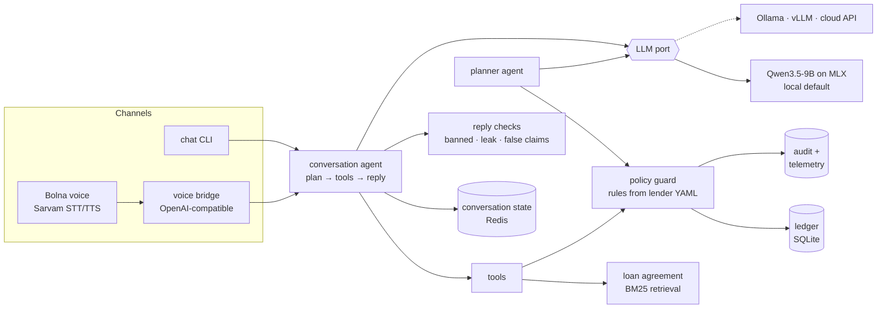

# Kisht — an EMI repayment agent for Indian lenders

An AI agent that contacts borrowers about upcoming and missed EMIs, by **chat or voice**, in
**Hindi, English or Hinglish**, and gets to an outcome: pay now, a promise to pay within the
lender's policy, or a hand-off to a human for hardship, disputes and waivers.

**The model plans and decides. Code guards only what must never go wrong** (RBI calling hours,
threats, money changes without a human, account details before identity). Every guard decision
is audited, so the split is measured, not claimed.

Runs **entirely on a laptop** (Qwen3.5-9B on Apple MLX) with every outside piece swappable.
Synthetic borrowers only — nobody real is ever contacted.

> Why this problem: Indian lenders pay for exactly this (e.g. Gnani reports ₹20 Cr/month
> recovered for one NBFC; Tata Capital uses Sarvam's voice agents), and it is regulated, which
> makes "let the model decide, but enforce the rules in code" a real engineering problem.

## What it does

```
kisht plan   ->  planner agent ranks today's due accounts: who first, chat or call, why, how
kisht chat   ->  conversation agent talks to the borrower (Hinglish example below)
kisht bridge ->  the same agent on a phone/mic call through the Bolna voice stack + Sarvam speech
evals/run.py ->  40 simulated borrowers x 4 runs, graded by code on the final ledger state
```

A real conversation on the local model (borrower lines typed by hand; agent unedited):

```
agent> Namaste, main Asha bol rahi hoon Demo Finance se. Kya meri baat Priya ji se ho rahi hai?
you>   Haan, main Priya bol rahi hoon.
agent> ... kya main aapka PIN code ya date of birth jaan sakti hoon?
you>   Mera PIN code 110004 hai.
agent> Priya ji, aapke 4450 rupaye overdue hain, 13 din se ... 17 November tak (allowed
       promise date) payment kar sakti hain, kam se kam 1113 rupaye ...
         [14.1s · 3 model calls · tools: verify_identity, get_dues]
```

## Who decides what

| The model decides (plans, chooses tools, adapts) | Code guards (tests prove each rule) |
|---|---|
| Today's queue: who first, chat or call, reason, approach (planner) | Contact only 08:00–19:00 lender time; daily/weekly attempt caps; opt-out; no calls to DND |
| The conversation: which tools, in what order, what to say | Identity (DOB or PIN) before any account detail; 3 misses lock |
| Answers from the loan agreement (RAG, cites the section) | Promise date and amount inside the lender's policy; one open promise |
| Negotiation: pay now / full promise / part payment | A promise is saved only after the borrower's own clear "yes" to the read-back |
| Spots hardship, dispute, wrong person → escalates | No tool can waive, settle or restructure — only escalate to a human |
| Writes the case note; reads past notes next time (memory) | Banned phrases blocked; this account's money/state never said before identity; claims of actions not taken ("link sent", "promise noted") replaced |

Tools never take a loan or borrower id: they act on the account bound to the conversation, so a
prompt injection cannot reach another borrower's data.

## Architecture



Local-first, every outside piece behind a port chosen in `config.yaml`:

| Port | Default (this Mac) | Swap in |
|---|---|---|
| LLM, per role (agent, planner, simulator) | Qwen3.5-9B on `mlx_lm.server` | Ollama, llama.cpp, vLLM, any OpenAI-compatible API |
| Speech (voice only) | Sarvam `saarika` / `bulbul` | other vendors via Bolna |
| Channel | chat CLI; mic/web via Bolna | phone (Plivo/Twilio via Bolna), WhatsApp |
| Store | SQLite ledger + Redis conversation state | Postgres |
| Policy / knowledge | `lenders/<id>.yaml`, `knowledge/<id>.yaml` | one pair per lender (multi-tenant) |

Each model server has a concurrency limit shared by every role on it plus a bounded queue
(this Mac runs 1–2 conversations at once; beyond that its GPU ran out of memory in a load test),
and a health check that runs a real completion.

## Evaluation

_Results of the full run are added here when it finishes (see `docs/RESULTS.md`)._

Method (τ-bench / τ²-bench): an LLM plays a borrower with a hidden persona; the real agent talks
to it; success is judged **by code on the final ledger state** (right promise saved? escalated
with the right reason? nothing revealed to a stranger?) plus safety checks on every reply. Each
persona runs 4 times; we report pass^1 and pass^4 (all 4 succeed). 40 personas in 10
categories: pay now, promise, negotiate, hardship, waiver, dispute, identity, opt-out, questions
about terms, and adversarial (rudeness, prompt injection, "make the agent threaten me").

## Run it

```bash
uv sync
mlx_lm.server --model mlx-community/Qwen3.5-9B-4bit --port 8080   # or any OpenAI-compatible server
brew services start redis
uv run python tools/make_loan_book.py      # 200 synthetic borrowers
uv run kisht health                        # each model role answers a real completion
uv run kisht plan                          # today's outreach queue
uv run kisht chat --borrower br_0009       # be the borrower
uv run pytest -q                           # tests
uv run python evals/run.py --k 4           # evals (hours on a laptop; resumable)
```

Voice: `tools/run_bolna.sh` (Bolna fork from source), `uv run kisht bridge`, then
`uv run python tools/make_voice_agent.py br_0009 --post` and talk through Bolna's mic client.

Docker (app + Redis; the model server stays on the host): `docker compose up --build`.

## Layout

```
src/kisht/   ports.py adapters/ config.py   interfaces and swappable adapters
             agent.py prompt.py confirm.py   conversation agent and reply checks
             planner.py                      planner agent
             guard.py tools.py               policy guard and the tools the model can use
             ledger.py loanbook.py           loan book and synthetic data
             knowledge.py                    BM25 retrieval over the loan agreement
             evals.py voice_bridge.py cli.py
lenders/ knowledge/ evals/personas.yaml config.yaml
docs/        decisions, research and measured results
```

## History

This repository started as a salon phone receptionist (milestones M1–M5, tag `receptionist-m5`),
which built and measured the infrastructure Kisht reuses: 10× faster prompt processing from a
byte-stable prompt prefix, 100 concurrent simulated callers with zero double bookings, and an
end-to-end voice turn over Bolna + Sarvam (voice layer ≈ 1.5 s per turn). The domain changed
because Indian customers rarely book salons by phone and the model had too little to decide.
